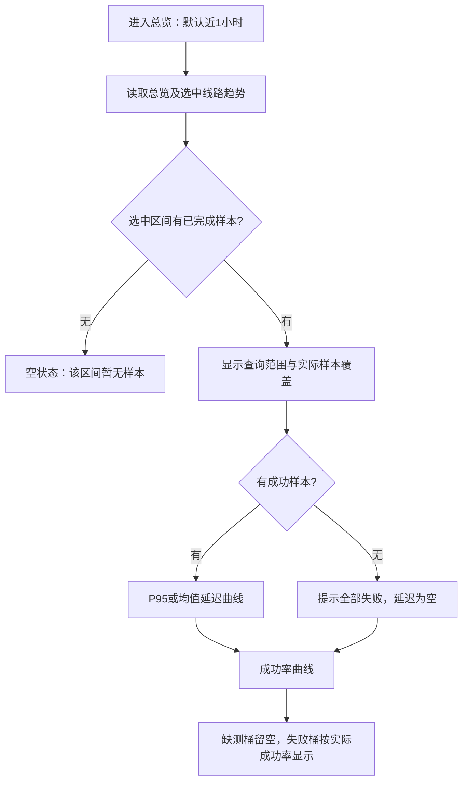

# 代理 OpenAI 监测总览：时间范围与样本覆盖

状态：概要设计，待实施。仅说明本次展示优化，不授权部署。

## 1. 问题与目标

总览当前默认查询近 24 小时。监测刚开启时，仅最近一段时间有样本，曲线集中在右侧，容易被误认为“初次进入没有数据”。切换近 1 小时后，时间轴缩短，曲线更容易观察。

目标：首次进入即可看清近期延迟波动，同时明确区分查询范围、实际样本覆盖和缺测。


## 2. 最小闭环

| 项目 | 设计 |
| --- | --- |
| 默认范围 | 首次进入默认近 1 小时 |
| 范围切换 | 保留近 1 小时／24 小时／7 天，由用户主动选择 |
| 聚合粒度 | 沿用现有规则：1 分钟／5 分钟／1 小时 |
| 查询范围 | 显示本次请求的开始、截止时间 |
| 实际覆盖 | 显示选中线路在区间内最早、最近的已完成样本时间 |
| 部分覆盖 | 显示“仅部分时段有样本，空白表示未采样或缺测” |
| 全部无样本 | 显示空状态，不绘制 0 延迟或 0% 成功率 |
| 全部失败 | 延迟为空；成功率为 0%，明确提示已有失败样本 |

选择 24 小时或 7 天时，继续显示完整查询时间轴，不自动缩短，以保留停机、暂停和缺测的可见性。

## 3. 页面展示



建议文案：

```text
统计区间：近1小时 · 每桶1分钟
查询范围：15:10–16:10
实际样本覆盖：15:23–16:09
仅部分时段有样本，空白表示未采样或缺测。
```

多线路的总覆盖为所选线路样本时间的并集边界，不能据此判断每条线路都有完整数据；悬停仍展示各线路桶内样本数和失败数。需要逐条核对时进入该线路详情。

## 4. 数据口径与接入

- 探测仍为通过代理访问 OpenAI `/v1/models`，仅衡量连通延迟，不代表模型生成速度。
- 成功率仍按已完成样本计算；均值、P95 仅用成功样本。
- 实际覆盖统计包含成功和失败样本，且与曲线使用相同的区间、当前连接指纹及完成时间过滤。
- 最早／最近样本时间应从原始样本聚合返回，不能用首个／最后一个桶的起点代替。
- UTC 存储，用户时区显示；查询区间保持左闭右开。

| 位置 | 最小改动 |
| --- | --- |
| `overview-state.ts` | 默认 `hours` 从 24 改为 1 |
| `trends.go` | 每条 series 增加可空 `first_sample_at`、`last_sample_at`，在既有批量查询中聚合 |
| `api.ts` | 同步趋势返回类型 |
| `OverviewTrends.vue` | 显示查询范围、选中线路总覆盖及部分覆盖说明 |

不调整采样间隔、后台调度、保留期、代理健康、用量或计费；不增加 migration、依赖或独立查询平台。刷新、取消请求和过时响应保护沿用现有实现。

## 5. 最小验收

- 首次进入默认近 1 小时，近期已有样本可直接看到曲线。
- 开启监测不足 1 小时时，覆盖时间正确，之前缺测留空。
- 切换 24 小时／7 天，完整时间轴保留，曲线不被自动裁剪。
- 无数据、全失败、多线路覆盖不同、连接配置变更时显示正确。
- 切换范围和自动刷新时，覆盖与曲线来自同一响应，旧响应不能覆盖新结果。
- 类型检查、定向组件测试与接口聚合测试通过，再更新实施状态。

## 6. 已知独立改进

前次审查指出的固定时钟边界分桶、按代理 ID 保持曲线身份与颜色，另行小闭环修复。本设计不将其标记为已完成，也不以时间范围优化替代这两项修复。
