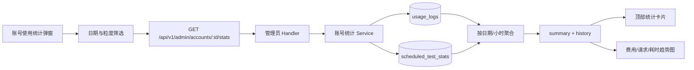
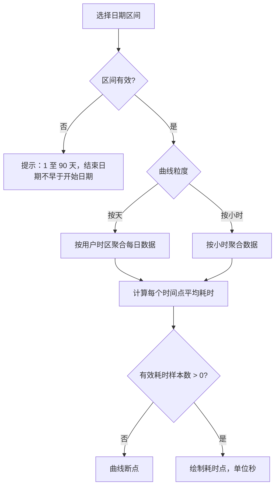

# 账号使用统计设计概要

## 1. 目标

在管理端账号详情的“使用统计”中，提供可按天选择的统计区间，并展示：

- 请求数、费用、Token 等基础统计；
- 所有已有耗时记录的平均请求耗时；
- 按天或按小时展示平均请求耗时的波动曲线。

## 2. 范围

### 已实现

- 快捷范围与自定义开始日期、结束日期；
- 起止日期均按用户时区解释，结束日期包含当天；
- 最大查询范围 90 天；
- `day` / `hour` 两种曲线粒度；
- 平均请求耗时顶部卡片与趋势曲线；
- 可选合并定时测试请求。

### 统计口径

平均耗时只统计 `duration_ms` 已记录的请求。`NULL` 耗时不会作为 `0ms` 参与平均；真实记录的 `0ms` 会参与计算。没有有效样本时显示 `—`。失败请求是否被纳入，取决于它是否产生了对应使用日志和耗时记录。

## 3. 数据流



## 4. 接口约定

```http
GET /api/v1/admin/accounts/:id/stats
```

### 查询参数

| 参数 | 说明 |
| --- | --- |
| `start_date` | 可选，`YYYY-MM-DD`，包含当天 |
| `end_date` | 可选，`YYYY-MM-DD`，包含当天 |
| `days` | 未提供自定义日期时使用，默认 30 天 |
| `granularity` | `day` 或 `hour`，默认 `day` |
| `include_tests` | 是否合并定时测试请求 |
| `timezone` | 用户时区，例如 `Asia/Shanghai` |

当 `start_date` 和 `end_date` 同时提供时，优先使用自定义区间。服务端将 `end_date` 转换为用户时区次日零点，使用半开区间查询：

```text
[start_of(start_date), start_of(end_date + 1 day))
```

## 5. 返回数据

```text
summary
  total_requests
  avg_duration_ms
  duration_sample_count

history[]
  date
  label
  requests
  actual_cost
  user_cost
  avg_duration_ms
  duration_sample_count
```

`duration_sample_count` 用于区分“没有耗时样本”和“平均耗时确实为 0ms”。

平均耗时计算：

```text
avg_duration_ms = SUM(duration_ms) / COUNT(duration_ms)
```

合并定时测试时，按各自有效样本数重新加权：

```text
combined_avg = (business_sum + test_sum) / (business_samples + test_samples)
```

## 6. 曲线设计

趋势图包含四条数据线：

| 曲线 | 轴 | 单位 |
| --- | --- | --- |
| 账号计费 | 左轴 | USD |
| 用户扣费 | 左轴 | USD |
| 请求数 | 右轴 | 次 |
| 平均请求耗时 | 独立右轴 | 秒 |

无耗时样本的点使用空值并断线，避免把缺失数据误画成 `0s`。空的日历日期会补齐到横轴，但不会制造耗时样本。



## 7. 前端职责

- `useAccountStats`：管理日期区间、粒度、测试开关、加载状态和请求取消；
- `AccountStatsFilters`：提供日期范围、粒度和测试开关；
- `AccountStatsModal`：展示卡片、趋势图和明细；
- `accountStatsDuration`：统一耗时格式化、秒值转换和趋势补点；
- `DateRangePicker`：复用快捷范围与自定义日期选择交互。

## 8. 校验与限制

- 前端和后端都校验日期格式、日期顺序和 90 天上限；
- 自定义日期采用“应用后查询”，避免用户编辑中间状态触发请求；
- 请求切换时取消旧请求，防止旧响应覆盖新结果；
- 平均耗时不等同于首字延迟（TTFT）；当前统计的是完整请求耗时；
- 当前方案不额外改造失败请求采集链路，统计完整性取决于现有日志记录。

